  <h1>✨ Bem vindo(a)! ✨ Welcome! ✨</h1>
  

  Estagiária em Software Embarcado na <b>Volvo</b> · Engenharia de Computação na <b>PUCPR</b>
  

  

***

<h1>Sobre mim 🌟 About me</h1>

<h4 align="left">Sou a <b>Yasmin Cardoso Magagnin</b>, uma profissional dedicada e apaixonada por tecnologia.</h4>
<h6 align="left">My name is <b>Yasmin Cardoso Magagnin</b>, a professional dedicated to and in love with technology.</h6>
<h4 align="left">Com raciocínio lógico afiado e facilidade em aprendizado, busco desafios que me permitam aplicar minha criatividade, dedicação e liderança.</h4>
<h6 align="left">With sharp logical reasoning and a quick learning ability, I seek challenges that allow me to apply my creativity, dedication, and leadership.</h6>
<h4 align="left">Atualmente, trabalho como estagiária em <b>Desenvolvimento de Software Embarcado na Volvo</b> e sou estudante de <b>Engenharia da Computação na PUCPR</b>.</h4>
<h6 align="left">Currently, I work as an intern in <b>Embedded Software Development at Volvo</b> and I'm a Computer Engineering student at <b>PUCPR</b>.</h6>

***

  <h3>Linguagens e tecnologias 🖥️ Languages and technologies</h3>

  
  
  
  
  
  
  
  
  
   
  
  
  
  
  
  
  

  <h3>Conecte-se comigo! 🔌 Connect with me!</h3>
  
  

